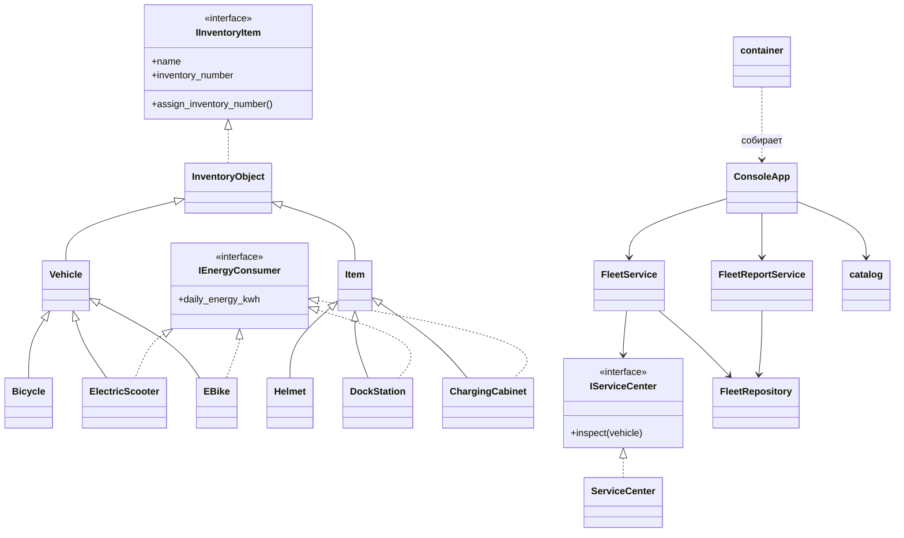

# ВышКат — учёт парка кикшеринга (ДЗ №1, КПО)

Консольное приложение: приём транспорта через техосмотр, постановка вещей на баланс,
инвентарные номера, отчёт по количеству и суточной энергии, список техники для новичков.
Зависимости собираются DI-контейнером `punq`.

## Функциональные требования

| № | Требование | Где реализовано | Как увидеть в демо |
|---|------------|-----------------|--------------------|
| 1 | Добавление транспорта в парк | `FleetService.accept_vehicle` (`services/fleet.py`), `ConsoleApp.accept_vehicle` (`console/app.py`), виды — `VEHICLE_KINDS` (`services/catalog.py`) | шаги «Приём электросамоката / велосипеда / электровелосипеда» |
| 2 | Техосмотр перед приёмкой | `IServiceCenter` / `ServiceCenter` (`services/service_center.py`); номер выдаётся только после `accepted` | «Отклонение: заявлены неисправности», «Отклонение: аномальный расход энергии» |
| 3 | Суммарное суточное потребление | `FleetReportService.total_daily_energy_kwh` (`services/reports.py`) по `IEnergyConsumer` | «Пустой парк…» (0.00) и «Отчёт: количество и суммарная суточная энергия» (6.75) |
| 4 | Устройства для новичков (простота ≥ 6; электротранспорт — ещё и расход ≤ 1 кВт·ч/сутки) | `Vehicle.is_beginner_friendly` + усиление в `_ElectricVehicle.is_beginner_friendly`, `BEGINNER_SIMPLICITY_THRESHOLD`, `BEGINNER_MAX_DAILY_ENERGY_KWH` (`domain/vehicles.py`), `FleetReportService.beginner_friendly_vehicles` | «Транспорт для новичков» |
| 5 | Вещи на балансе + номера вместе с техникой | `Item`, `Helmet`, `DockStation`, `ChargingCabinet` (`domain/items.py`), `FleetService.add_item`, `FleetReportService.inventory` | шаги «Вещь…», «Инвентарная опись техники и вещей» |
| 6 | Демонстрация всех сценариев | `console/demo.py` (`DEMO_STEPS`), запуск `python -m vyshcat --demo` | пустой парк, приём, оба вида отказа, некорректный ввод, вещи, отчёты, выход |

## Запуск

Нужен Python ≥ 3.11.

```bash
python -m venv .venv
source .venv/bin/activate          # Windows: .venv\Scripts\activate
pip install -r requirements.txt
python -m vyshcat                   # интерактивное меню
python -m vyshcat --demo            # демонстрация по заготовленному сценарию
pytest                              # тесты + покрытие (настроено в pyproject.toml)
pytest --cov=vyshcat --cov-report=term-missing
ruff check . && ruff format --check .
mypy --strict vyshcat
```

Фактический результат: **125 тестов пройдено, 0 xfail, покрытие 99%** (statements + branches),
ruff и `mypy --strict` без замечаний.

## Архитектура

```
vyshcat/
  __main__.py            точка входа: меню или --demo
  container.py           build_container — единственное место выбора реализаций (punq)
  domain/                модель, без зависимостей от сервисов и консоли
    interfaces.py        IInventoryItem, IEnergyConsumer — роли объектов
    inventory.py         InventoryObject — имя и однократно выдаваемый номер
    vehicles.py          Vehicle, Bicycle, ElectricScooter, EBike; правило новичков
    items.py             Item, Helmet, DockStation, ChargingCabinet
    _validation.py       require_energy — общая проверка расхода (транспорт и вещи)
  services/
    service_center.py    IServiceCenter, ServiceCenter, InspectionResult — техосмотр
    fleet.py             FleetService — техосмотр → номер → в репозиторий
    repository.py        FleetRepository — хранение в памяти
    reports.py           FleetReportService — отчёты (только чтение)
    catalog.py           VEHICLE_KINDS, ITEM_KINDS — каталог видов для меню
  console/
    io.py                ConsoleIO (input/print), ScriptedIO (заготовленный ввод)
    prompts.py           Prompter — ввод с повтором до корректного значения
    app.py               ConsoleApp — меню
    demo.py              DEMO_STEPS, build_demo_io
```



(Электротранспорт и вещи-потребители реализуют `IEnergyConsumer` через внутренние базы
`_ElectricVehicle` и `_PoweredItem`, чтобы не дублировать хранение расхода.)

## Ключевые решения

| Решение | Почему | Отвергнутая альтернатива |
|---------|--------|--------------------------|
| Две роли-ABC: `IInventoryItem` и `IEnergyConsumer` (`domain/interfaces.py`) | Так требует условие; у ролей разные потребители: опись работает с номером, отчёт по энергии — с расходом | Одна база «Устройство» с `daily_energy_kwh = 0` у всех — врёт про велосипед и шлем |
| `Bicycle` и `Helmet` не реализуют `IEnergyConsumer` | ISP: им нечего возвращать; LSP: нет «нулевых» заглушек, которые нарушали бы смысл роли | Поле `energy: float | None` — проверки на `None` расползлись бы по коду |
| `Vehicle` и `Item` — обычные классы, не ABC | Абстрактного метода у них нет, а ABC без абстрактных методов ничего не запрещает — это был бы декоративный ABC | Ввести абстрактное свойство «вид» ради ABC — дублировало бы названия из `catalog.py` |
| Номер выдаётся только после техосмотра (`FleetService.accept_vehicle`) | «Техника попадает в активный парк только после техосмотра»; отклонённая не тратит номер | Выдавать номер при вводе, а потом «помечать отклонённой» — в описи оказались бы непринятые объекты |
| Счётчик номеров — `FleetRepository.next_number()`, префикс добавляет `FleetService` | Номер монотонный и не зависит от числа объектов: после будущего списания номера не повторятся; источник истины один на всех `FleetService` | `len(repository.all()) + 1` — при удалении объекта номер выдался бы повторно |
| Вещи ставятся без техосмотра (`FleetService.add_item`) | Шлем и шкаф не ездят: неисправность и аномальный расход проверяются у транспорта; заказчик требует техосмотр именно для техники | Общий техосмотр для всего — `ServiceCenter` знал бы про шлемы, без пользы |
| Каталог видов `services/catalog.py` | Точка расширения: меню строится по `VEHICLE_KINDS`/`ITEM_KINDS`, новый вид = класс + строка; нужен ли запрос расхода — выводится из того, реализует ли класс `IEnergyConsumer` | `if kind == ...` в `ConsoleApp` — каждая новинка правит UI |
| `punq`, подмена через параметр `build_container(service_center=..., io=...)` | В punq при повторной регистрации того же типа побеждает последняя — поведение неявное; поэтому каждый тип регистрируется ровно один раз, а подмена — явный аргумент | «Перерегистрировать `IServiceCenter` в тесте» — тест зависел бы от порядка регистраций в punq |
| Нет интерфейса репозитория — конкретный `FleetRepository` | Реализация одна, тестам подменять хранилище не нужно (они используют настоящее in-memory); интерфейс без второй реализации — декоративный DIP. Появится файл/БД — интерфейс выделяется из методов `add/all/vehicles/items/next_number` | `IFleetRepository` + `InMemoryFleetRepository` (было в первой версии, убрано) |
| Нет отдельной «политики новичков» | Правило живёт в самих классах: база `simplicity ≥ 6` в `Vehicle.is_beginner_friendly`, электротранспорт усиливает его через `super()` условием «расход ≤ `BEGINNER_MAX_DAILY_ENERGY_KWH` = 1.0» (мощная техника тяжелее в управлении). Стратегия появится, когда правил станет несколько (например, учитывать погоду или категорию клиента) | `IBeginnerPolicy` с одной реализацией |

Инварианты домена: простота — только `int` 1–10 (`bool` и дробные отвергаются), расход — конечное
число ≥ 0 (`require_energy` отвергает NaN и ±inf), имя непустое, номер выдаётся один раз.

## SOLID

- **S** — у каждого класса одна причина меняться: техосмотр — `ServiceCenter`, постановка на
  баланс — `FleetService`, отчёты — `FleetReportService`, хранение — `FleetRepository`,
  ввод с повтором — `Prompter`, физический ввод-вывод — `ConsoleIO`, сборка — `container.py`.
- **O** — новый вид транспорта или вещи добавляется классом и строкой в `services/catalog.py`;
  `ConsoleApp`, `FleetService`, `FleetReportService` не меняются. Новые правила техосмотра —
  новая реализация `IServiceCenter`.
- **L** — любой `Vehicle` подставляется в `ServiceCenter.inspect` и отчёты; подклассы не
  ослабляют инварианты базы (проверка простоты и имени в `Vehicle`/`InventoryObject`).
  `_ElectricVehicle.is_beginner_friendly` только усиливает правило базы (`super()` и расход),
  поэтому «подходит новичку» у электротранспорта всегда влечёт «подходит» по правилу `Vehicle`.
  Нет «пустых» реализаций интерфейсов: велосипед не притворяется потребителем энергии.
- **I** — роли раздельные (`IInventoryItem`, `IEnergyConsumer`), объект реализует только то,
  что умеет; тест `test_non_powered_objects_are_not_energy_consumers` (`tests/test_domain.py`).
- **D** — `FleetService` зависит от абстракции `IServiceCenter`, конкретная реализация
  выбирается в `build_container`; `ConsoleApp` получает зависимости и `ConsoleIO` через
  конструктор. Применён там, где есть реальная вариативность (заглушки техосмотра в тестах,
  `ScriptedIO` в демо), и не применён к репозиторию (см. выше).

## Обязательные вопросы

### Какой принцип SOLID применён наиболее явно и где

DIP вместе с DI: `FleetService.__init__(repository, service_center: IServiceCenter)`
(`services/fleet.py`) не знает, какой техосмотр работает; реализация выбирается в
`build_container` (`container.py`). Это даёт подмену техосмотра в тестах без мок-библиотек
(`AlwaysAcceptCenter`, `AlwaysRejectCenter`, `SpyServiceCenter` в `tests/conftest.py`).
Рядом ISP: `IInventoryItem` и `IEnergyConsumer` в `domain/interfaces.py`.

### Какой принцип сознательно ограничен / «почти нарушен» и почему это приемлемо

- **OCP / LSP через `isinstance`.** `ServiceCenter.inspect` и
  `FleetReportService.total_daily_energy_kwh` проверяют `isinstance(x, IEnergyConsumer)`,
  `FleetReportService.inventory` — `isinstance(o, Vehicle)`, `FleetRepository.vehicles/items` —
  тоже `isinstance`. Альтернатива — `daily_energy_kwh = 0` у всех, что ломает ISP и смысл роли.
  Проверка идёт по роли, а не по конкретному классу, поэтому новый вид с энергией учитывается
  автоматически.
- **DIP для репозитория не применён:** `FleetService` и `FleetReportService` зависят от
  конкретного `FleetRepository`. Приемлемо, пока хранилище одно (см. «Ключевые решения»).
- **SRP/OCP у `ConsoleApp`:** меню знает про все пять действий (`self._actions`, текст `MENU`).
  Новое действие (например, отчёт по сотрудникам) потребует правки `console/app.py`. Для пяти
  пунктов отдельная система «команд-плагинов» — overengineering.
- **Каталог передаёт дефолтные параметры:** фабрика велосипеда в `catalog.py` игнорирует расход
  (`lambda n, s, _e, d: Bicycle(n, s, d)`) — единая сигнатура фабрики ценой одного
  неиспользуемого аргумента.

### Что сломается / не сломается при расширении

- **Новый вид транспорта (например, моноколесо).** Класс в `domain/vehicles.py`
  (`class Monowheel(_ElectricVehicle)`) + строка в `VEHICLE_KINDS` (`services/catalog.py`) вида
  `VehicleKind("Моноколесо", Monowheel, Monowheel)`. Запрашивать ли расход, каталог выводит
  из класса (`issubclass(cls, IEnergyConsumer)`), отдельного флага нет — рассинхрон невозможен.
  Меню, техосмотр, отчёты, опись, правило новичков работают без правок. Если появится
  специфичная проверка техосмотра — правится только `ServiceCenter`.
- **Сотрудник службы эксплуатации.** На баланс не ставится, поэтому `IInventoryItem` не
  реализует и не попадает ни в `FleetRepository`, ни в опись — существующее не ломается.
  Понадобятся новые модуль `domain/staff.py`, сервис (например, `StaffService`) со своим
  хранилищем, регистрация в `container.py`, пункт меню в `console/app.py` (тот самый
  «почти нарушенный» OCP у `ConsoleApp`).
- **Склад запчастей.** Если запчасти — объекты на балансе, это новый подкласс `Item`
  (+ строка в `ITEM_KINDS`), всё остальное работает. Если нужен складской учёт (остатки,
  количество, списание) — это отдельный сервис и хранилище; тогда, вероятно, появится второе
  хранилище, и это момент выделить интерфейс репозитория. Сквозная нумерация не пострадает:
  монотонный счётчик живёт в `FleetRepository.next_number()` и не зависит от числа объектов,
  поэтому списание не приведёт к повтору номеров; `FleetService._register` лишь добавляет префикс.

### Какой тест фиксирует решение техосмотра и правило «для новичков»; как подменяется зависимость

- Решение реального техосмотра: `tests/test_service_center.py` —
  `test_inspect_with_defects_rejected_and_reason_lists_defects`,
  `test_inspect_energy_above_threshold_rejected`,
  `test_inspect_energy_exactly_at_threshold_accepted`,
  `test_inspect_energy_just_above_threshold_rejected`.
- Порядок «техосмотр → номер»: `tests/test_fleet_service.py` —
  `test_accept_vehicle_inspection_happens_before_registration` (через `SpyServiceCenter`),
  `test_accept_vehicle_rejected_gets_no_number`, `test_rejected_vehicle_does_not_consume_number`.
- Правило новичков: `tests/test_domain.py` — `test_beginner_rule_simplicity_6_is_friendly`,
  `test_beginner_rule_simplicity_5_is_not_friendly`,
  `test_beginner_rule_electric_energy_exactly_1_is_friendly`,
  `test_beginner_rule_electric_energy_above_1_is_not_friendly`,
  `test_beginner_rule_low_energy_does_not_override_simplicity`,
  `test_beginner_rule_bicycle_only_by_simplicity`; `tests/test_reports.py` —
  `test_beginner_list_includes_only_simplicity_6_and_above`, `test_beginner_list_excludes_items`.
- Подмена через DI: `tests/test_container_di.py` —
  `test_container_with_rejecting_stub_fleet_rejects_serviceable_vehicle` и
  `test_container_with_accepting_stub_fleet_accepts_defective_vehicle`: заглушка передаётся
  в `build_container(service_center=AlwaysRejectCenter())`, контейнер внедряет её в
  `FleetService`; исправный самокат отклоняется, неисправный — принимается, то есть решение
  действительно приходит из внедрённой зависимости. Через UI то же проверяет
  `test_menu_accept_uses_injected_service_center` (`tests/test_console.py`).

### Применение ИИ

Сlaude code применялся для:
- генерации кода и тестов по утверждённой архитектуре
- поиск граничных случаев: NaN/inf в расходе, дробная «простота»,
  повтор инвентарных номеров, битая кодировка ввода;
- черновик README.

Мной выбраны и утверждены:
- язык и стек (Python + `punq` + pytest);
- подробная архитектура
- способ подмены техосмотра через параметр `build_container(service_center=...)`;
- доработки по итогам ревью:
  - правило новичков усложнено ограничением расхода для электротранспорта;
  - счётчик номеров перенесён в `FleetRepository`, чтобы номера не повторялись после будущего списания техники.

## Пример вывода демо (фрагмент `python -m vyshcat --demo`)

```
########## ДЕМО: Пустой парк: отчёт, новички и опись до приёма техники ##########
Пункт меню: 3
Транспорт: 0 ед.
Вещи: 0 ед.
Всего на балансе: 0 ед.
Суточное потребление: 0.00 кВт·ч
...
ПРИНЯТ: «Ninebot Max G30», инв. № VC-000001.
ОТКЛОНЁН: «Kugoo S3» — заявлены неисправности: тормоз, люфт руля.
ОТКЛОНЁН: «Монстр 3000» — аномальный расход 9.50 кВт·ч/сутки (норма не более 5.00).
...
Суточное потребление: 6.75 кВт·ч
...
Можно выдавать новичкам:
  VC-000001  Ninebot Max G30 (простота 8)
  VC-000002  Stels Navigator (простота 9)
  VC-000004  Xiaomi 4 Pro (простота 7)
...
Инв. номер  | Вид       | Наименование
VC-000001   | транспорт | Ninebot Max G30
VC-000002   | транспорт | Stels Navigator
VC-000003   | транспорт | Eltreco XT 800
VC-000004   | транспорт | Xiaomi 4 Pro
IT-000005   | вещь      | Шлем детский S
IT-000006   | вещь      | Док у корпуса Покровка
IT-000007   | вещь      | Шкаф на Мясницкой
```
